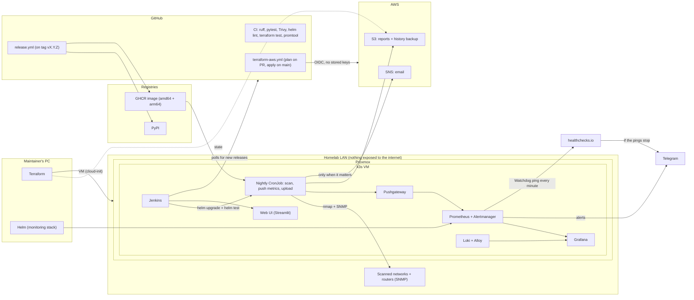
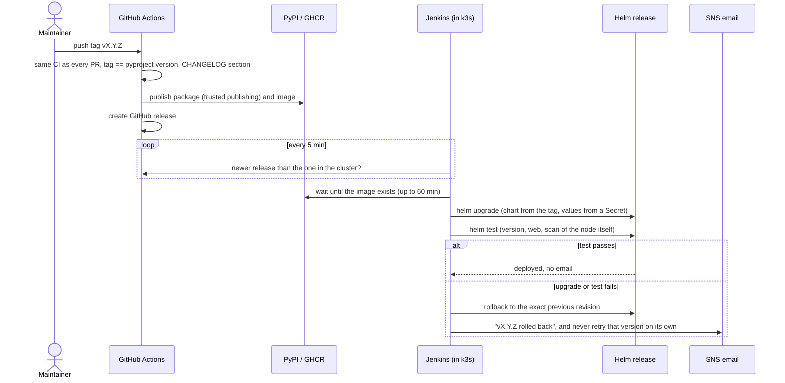

# Architecture

How the scanner is built, released, deployed, watched and backed up: the
platform around the tool, phase by phase, with the reasons behind it. It is a
one-person homelab (one Proxmox host, one k3s node), not a production system,
and the decisions below are sized for that.

The step-by-step runbooks and the full decision log are in Spanish:
[`devops/README.md`](devops/README.md) and [`decisiones.md`](decisiones.md).

- [Overview](#overview)
- [Release flow](#release-flow)
- [Phases](#phases)
- [Decisions worth asking about](#decisions-worth-asking-about)
- [What it doesn't do](#what-it-doesnt-do)

## Overview

Two tools for delivery, on purpose: **GitHub Actions** tests and publishes
(it runs in the cloud and can't reach the LAN); **Jenkins**, inside the
cluster, deploys (it polls GitHub every 5 minutes, so nothing has to come in).

## Release flow

## Phases

Each phase ended with a runbook and, where it made sense, a real failure
rehearsal rather than a "should work".

| # | Phase | What it added | Why | Runbook (in Spanish) |
|---|-------|---------------|-----|----------------------|
| 0 | AWS account hygiene | MFA on root and no root keys, a $5 monthly budget alert, a day-to-day IAM Identity Center user | A personal account that can't surprise anyone on the bill | [00-cuenta-aws.md](devops/runbooks/00-cuenta-aws.md) |
| 1 | Container | Multi-stage image, nmap without root, Trivy in CI, GHCR | Run it anywhere with the least privilege nmap really needs | [01-contenedor.md](devops/runbooks/01-contenedor.md) |
| 2 | Proxmox VM as code | Terraform (`bpg/proxmox`) VM with cloud-init and k3s, state in S3 | Rebuild the node from the repo, not from memory | [02-proxmox-vm.md](devops/runbooks/02-proxmox-vm.md) |
| 3 | Kubernetes | Helm chart: nightly CronJob, web UI, history on a PVC, SNMPv3 Secret | Scans run by themselves every night | [03-kubernetes.md](devops/runbooks/03-kubernetes.md) |
| 4 | AWS as code + findings | S3 for reports and a versioned history backup, SNS email, GitHub OIDC roles | Off-site copy of the history and a short email when the network changes | [04-aws.md](devops/runbooks/04-aws.md) |
| 5 | Continuous deployment | Jenkins (JCasC, pinned plugins) deploying every published tag, with test and rollback | A release reaches the homelab without anyone typing `helm upgrade` | [05-jenkins.md](devops/runbooks/05-jenkins.md) |
| 6 | Observability | kube-prometheus-stack, Pushgateway, scanner alerts tested with promtool, Grafana dashboard, Telegram, external watchdog | Know when the nightly scan didn't happen, not just when it failed loudly | [06-observabilidad.md](devops/runbooks/06-observabilidad.md) |
| 7 | Logs | Loki (single binary) and Alloy reading through the Kubernetes API | Read a scan's logs after its Job is gone, and the events that explain a dead pod | [07-logs.md](devops/runbooks/07-logs.md) |

Infrastructure lives in [`infra/`](../infra) (Terraform), the chart in
[`deploy/helm/`](../deploy/helm), Jenkins in [`deploy/jenkins/`](../deploy/jenkins)
and the monitoring stack in [`deploy/monitoring/`](../deploy/monitoring).
Real values (IP ranges, domains, credentials) never enter the repo: they live in
ignored files on the maintainer's PC and in Kubernetes Secrets.

## Decisions worth asking about

Short versions; the full reasoning (and the bug that prompted many of them) is in
[`decisiones.md`](decisiones.md).

- **No long-lived AWS keys in GitHub.** Terraform for AWS runs from GitHub
  Actions through OIDC with two roles: read-only plan on pull requests,
  apply only from `main` inside an environment that needs a manual approval.
  The trust policy uses GitHub's immutable `sub` (`repo:<owner>@<id>/<repo>@<id>`),
  so a deleted-and-recreated repo with the same name can't assume the role.
  The homelab itself does use a static IAM key (least privilege, rotation
  documented); IAM Roles Anywhere would remove it at the cost of running a PKI.
- **Deploy without staging, but never without a safety net.** With one node
  and `hostNetwork`, a staging copy would prove little and cost the most memory.
  Instead: `helm test` after every upgrade, rollback to an explicit revision
  (not `rollback 0`, which goes one version too far if the upgrade failed before
  creating a revision), an email, and a marker so a broken version isn't
  retried on every poll. All of it rehearsed with deliberately broken deploys.
- **Pin what you run.** Third-party GitHub Actions by commit SHA, Trivy and
  every image by digest, runners by version (`ubuntu-26.04`, never `-latest`),
  Jenkins plugins as a full pinned list. Tests in [`tests/test_workflows.py`](../tests/test_workflows.py)
  enforce it. The trigger was the March 2026 attack that rewrote the tags of
  `aquasecurity/trivy-action`; new releases also wait two weeks before adoption.
- **nmap without root.** File capabilities on the binary (`setcap`), a fixed
  non-root UID, and the pod adds exactly those capabilities on top of
  `drop: [ALL]`. A test reads the Dockerfile and the chart and fails if they
  disagree, because one missing capability means nmap silently won't start.
- **Who watches the watchers.** Alertmanager pings healthchecks.io every
  minute with the always-firing `Watchdog` alert; if Prometheus, Alertmanager or
  the VM die, the pings stop and healthchecks.io alerts on Telegram. A dead
  monitoring stack otherwise looks exactly like "all quiet".
- **The app knows nothing about AWS or Prometheus.** It writes files
  (`--changes-dir`, `--history-backup`, `--metrics-file`); small containers in
  the same Job upload them. The app stays testable with pytest, and the
  platform pieces can be swapped without a release.
- **Alerts people won't learn to ignore.** The nightly email only fires for a
  host never seen before with open ports, or a port change; devices that come
  and go every night don't count. Rules that are always true on a single node
  (overcommit, control-plane targets k3s doesn't expose) are removed instead
  of silenced.
- **Backups are only real once restored.** The history PVC was deleted on
  purpose and restored from the S3 copy; the monitoring stack was uninstalled
  and reinstalled from the repo; Jenkins was rebuilt from scratch. Each
  rehearsal found something that went into the runbooks.

## What it doesn't do

- **No high availability.** One Proxmox host, one k3s node. If the host is
  off, the nightly scan doesn't run (Kubernetes catches up on the missed run
  when the node is back); power cuts are explicitly out of scope.
- **No access from outside the LAN.** The web UI, Jenkins and Grafana sit
  behind a reverse proxy restricted to the local network. The web UI has no
  authentication of its own; an allow-list of ranges limits what it will scan.
- **No log-based alerting.** Alerts come from Prometheus; Loki is for reading
  what happened.
- **Not a security audit.** Flagged ports (Telnet, SMB, RDP, FTP, VNC) are a
  visual signal, and the topology without SNMP is an approximate star.
